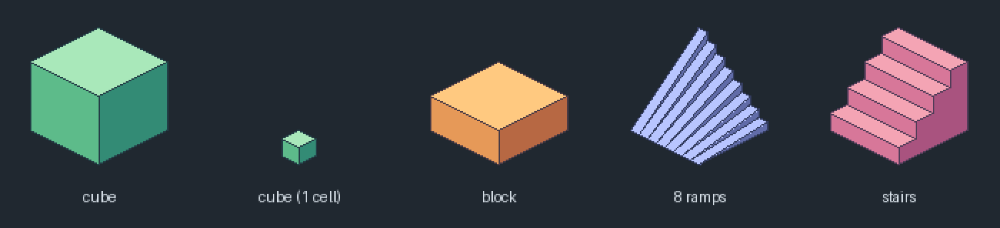

# py-tilix

A Python library for generating isometric pixel art shapes. Create reusable
geometry, choose a grid and palette, and render crisp RGBA images with Pillow.
Includes cubes, rectangular blocks, ramps, and solid stairs.



The grid is inspired by [eBoy's TiliX](https://c6y.github.io/tilix-reference/):
2:1 ground axes, paired horizontal pixels on isometric edges, and vertical edges
anchored to the right pixel of each pair. Exposed left corners use only the
right-pixel anchor where a diagonal meets a vertical or another slope, avoiding
an extra pixel sticking out. This is an independent implementation;
it does not bundle eBoy artwork or claim full TiliX asset compatibility.

## Setup

Python 3.12 is pinned in `.python-version`; uv selects the interpreter and manages
the local `.venv`. Install [uv](https://docs.astral.sh/uv/getting-started/installation/),
then run:

```sh
uv python install 3.12
uv sync --locked
uv run python examples/gallery.py
```

The example saves five transparent sprites and a gallery to `output/`. The cube,
block, combined ramps, and stairs each have a one-block base: 4×4 cells, each cell a
square of 7×7 dual pixels. Their heights vary independently of the base footprint.
A second cube, saved as `cell_cube.png`, measures 1×1×1 cells and appears beside
the block-sized cube at the same pixel scale for comparison.
The eight ramps are composed into one sprite, `ramps.png`. Each ramp is 1/8 block
(half a cell) wide and one block deep. They touch along x, together filling a
single 4×4-cell base. Their heights descend from one block to 1/8 block in
1/8-block steps. The composition uses a shared ground plane and draws only
exposed surfaces, so hidden side edges do not show through adjacent ramps.

## Use the library

```python
from tilix import Palette, cube, render, stairs

image = render(cube(), scale=4)
image.save("cube.png")

palette = Palette(
    top="#ffd58a",
    left="#dda25e",
    right="#a76b46",
    outline="#433d45",
)
render(stairs(width=4, depth=4, height=2, steps=4), palette=palette).save("stairs.png")
```

`render()` returns a `PIL.Image.Image` in RGBA mode. Use it with Pillow to composite
sprites, build sheets, or export other image formats. From another uv project,
install this checkout with `uv add /path/to/py-tilix`.

### Geometry

All dimensions are in cells. Coordinates start at `(0, 0, 0)`: x points down-right,
y points down-left, and z points up. Ramps and stairs are highest at y=0 and descend
toward y=depth. Dimensions must be positive and finite.

| Function | Parameters | Result |
| --- | --- | --- |
| `cube(size=4)` | One side length | Equal width, depth, and height |
| `block(width=4, depth=4, height=4)` | Independent dimensions | Rectangular block |
| `ramp(width=4, depth=4, height=4)` | Independent dimensions | Solid sloping wedge |
| `stairs(width=4, depth=4, height=4, *, steps=4)` | Dimensions and positive integer step count | Equal treads and risers |

Shapes are immutable and independent of resolution. `shape.translated(x, y, z)`
returns a new shape. Since rendering automatically crops to its bounds, translating
a single shape preserves its sprite when the new coordinates remain grid-aligned.

### Grid and subdivisions

The default `Grid(cell_size=12)` projects a cell 12 pixels horizontally and 6
vertically along either ground axis, and 12 pixels straight up along z. Each
ground edge contains seven dual pixels, counting both endpoints: a cell is a
7×7-dual-pixel square, and a block is 4×4 cells. A default cube is one block wide
and deep, and four cells tall. Its padded sprite is 105 × 105 native pixels.

```python
from fractions import Fraction
from tilix import Grid, block, render

shape = block(width=4, depth=4, height=Fraction(1, 3))
image = render(shape, grid=Grid(cell_size=12))

# A quarter-cell height requires a compatible larger cell size.
image = render(block(width=4, depth=4, height=Fraction(1, 4)), grid=Grid(cell_size=24))
```

The projection is `screen_x = (x - y) * cell_size` and
`screen_y = (x + y) * cell_size / 2 - z * cell_size`. Vertices must land on integer
right-pixel anchors satisfying `(screen_x - 2 * screen_y) % 4 == 0`. Misaligned
geometry raises `ValueError`; the renderer never silently rounds a shape into
place. Integer, float, and `Fraction` dimensions are accepted; prefer `Fraction`
for exact subdivisions. The default grid supports halves, thirds, and sixths.
For other step counts or subdivisions, increase `cell_size` to a compatible even
number. Change the grid to add native detail; change `scale` to enlarge pixels.

### Rendering and colors

```python
render(
    shape,
    grid=Grid(cell_size=12),
    palette=Palette(outline=None),
    padding=4,
    scale=3,
    background=(0, 0, 0, 0),
).save("shape.png")
```

`padding` is a nonnegative integer measured in native pixels. `scale` is a positive
integer applied with nearest-neighbor sampling, so enlarged sprites keep their
original colors and sharp pixels. Colors accept Pillow color strings and RGB or
RGBA integer tuples. `outline=None` disables the outline. Face alpha values are
written directly into the image; composite with Pillow to blend translucent art
onto a background. There is no antialiasing or automatic lighting.

### Custom shapes

```python
from tilix import Face, Shape, render

tile = Shape(
    (
        Face(
            vertices=((0, 0, 0), (4, 0, 0), (4, 4, 0), (0, 4, 0)),
            shade="top",
        ),
    )
)
render(tile).save("tile.png")
```

Provide visible polygon faces in drawing order, with vertices around each
perimeter and a `top`, `left`, or `right` palette shade. This version renders
individual shapes. It does not perform scene depth sorting, hidden-surface
removal, mesh intersections, or boolean operations. All supplied faces and their
edges are drawn. Built-in primitives supply the visible surfaces for the fixed
camera. Isometric 2:1 edges use dual pixels; other ramp slopes use one-pixel raster
lines. Rotate geometry and render again when adding orientations; mirroring a
finished sprite would swap left and right pixel anchors.

## Development

```sh
uv sync --locked
uv run pytest
uv run ruff check .
uv run ruff format --check .
uv build
```
